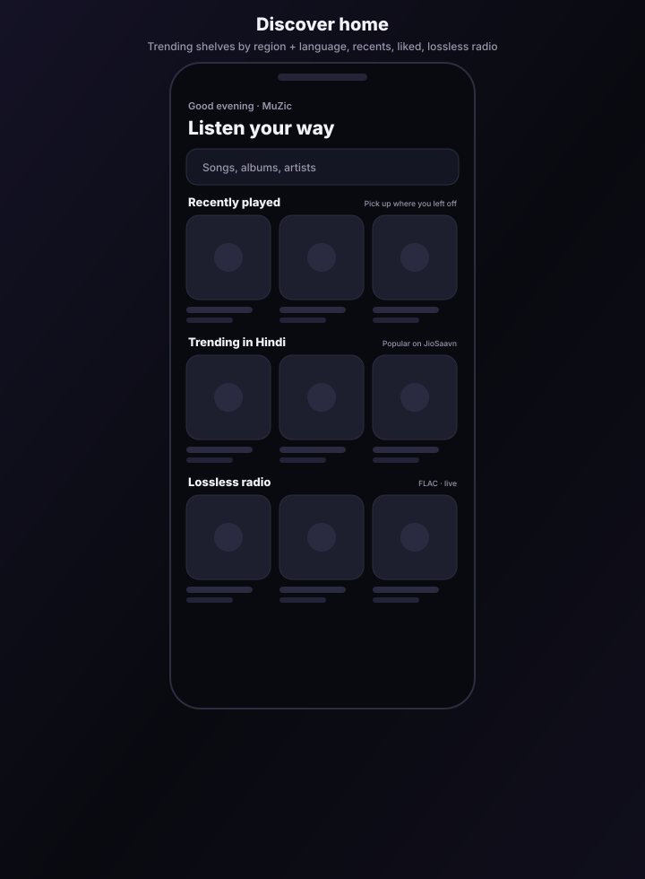
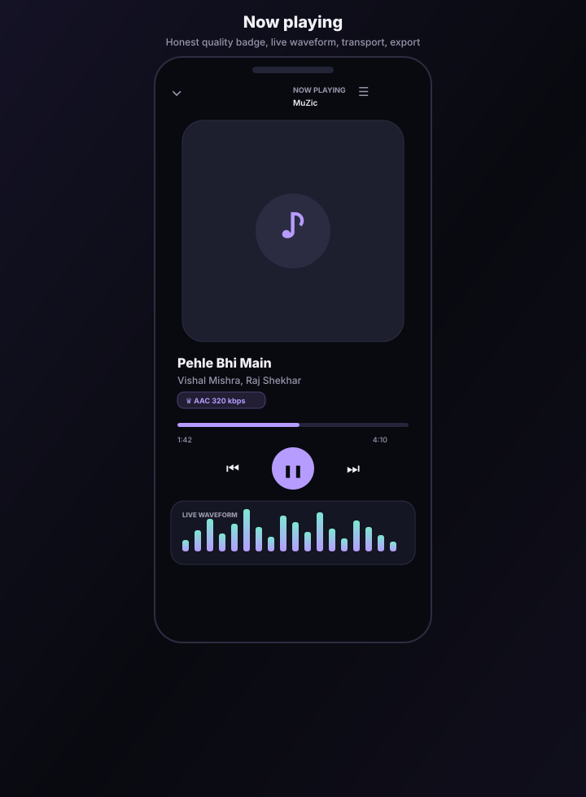
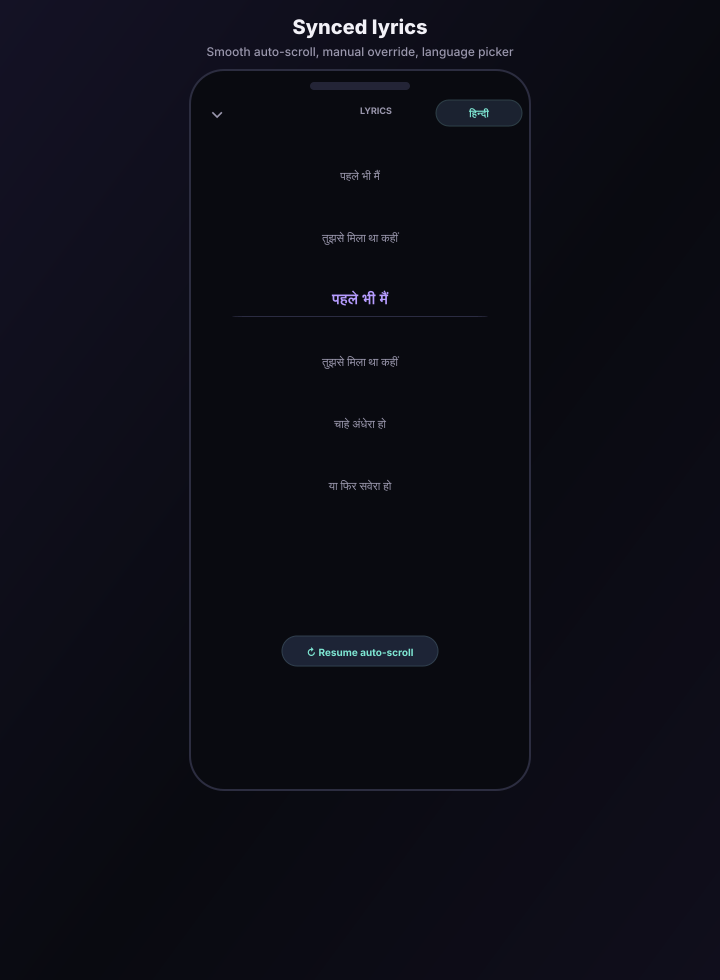
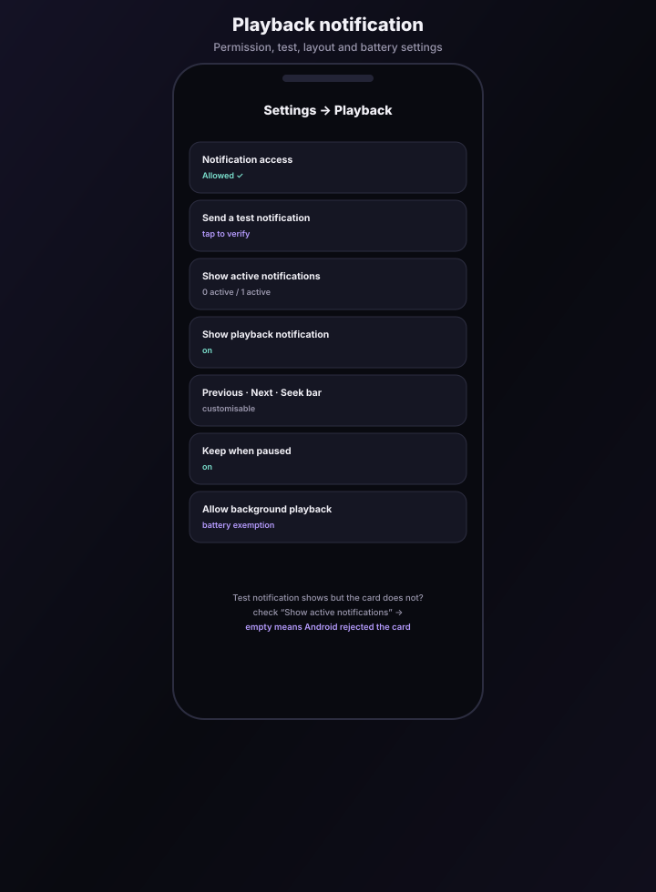
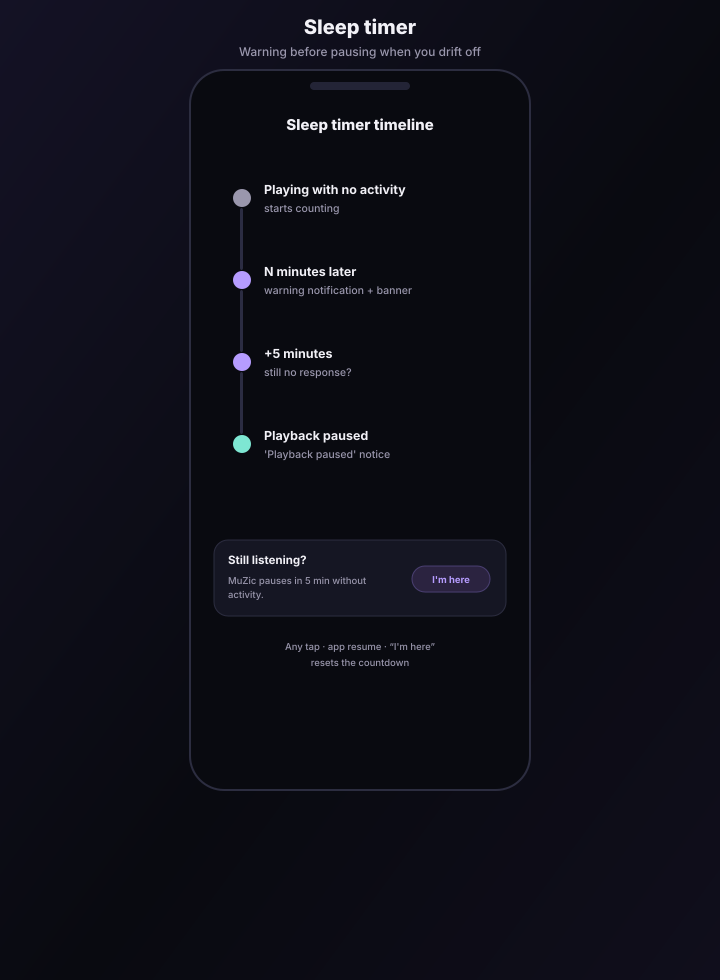
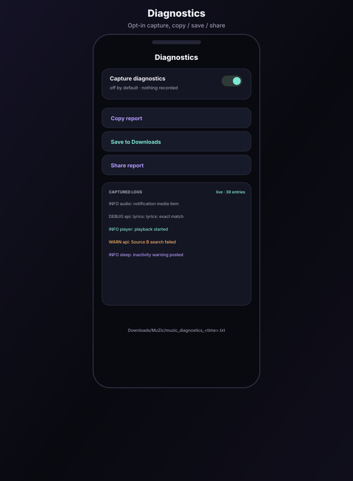
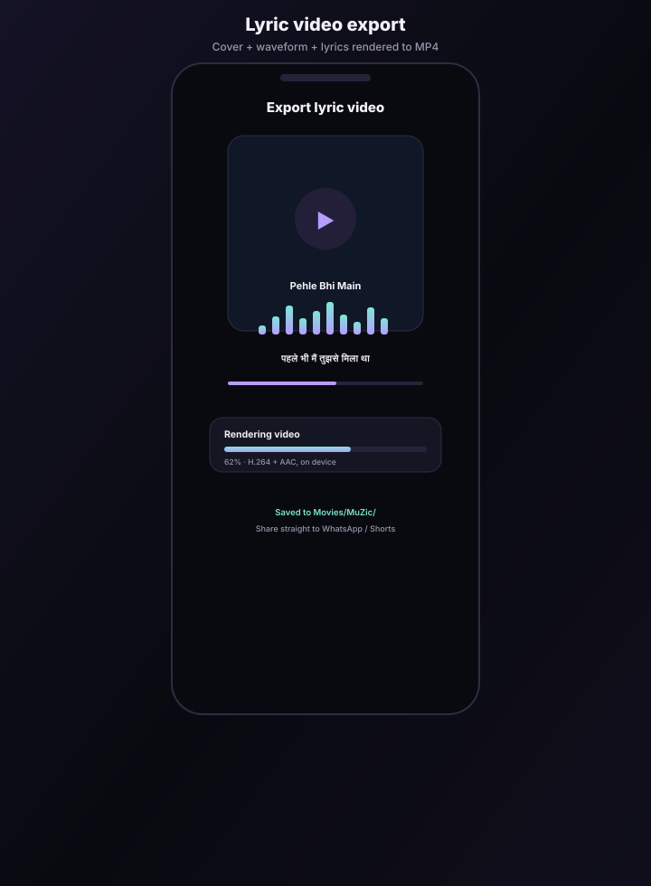

# MuZic — User Guide

Everything MuZic can do, screen by screen. The pictures below are **schematic
illustrations** of each screen (drawn to match the app's dark theme), not device
screenshots.

---

## 1. Install & update

| What | How |
| --- | --- |
| **Install** | Open the latest release on GitHub → **Assets** → download `app-arm64-v8a-release.apk` (most phones) → tap it → *Install anyway* if Android warns about an unknown source. |
| **Older 32-bit phone** | Use `app-armeabi-v7a-release.apk` instead. |
| **Update** | Download the newest APK and install it over the old one. Every MuZic build is signed with the same key (`04d6c78f…`) and bumps the version code, so it updates in place — **no uninstall needed**. |
| **If you ever see "package conflicts"** | You are installing over an old build from before the signing fix. Uninstall MuZic once, then install the new APK. This will not happen again. |
| **Version** | Settings → About shows the version (for example, `1.5.41+50`). |

---

## What's new in 1.5.41

- **The lock-screen card moves in time:** the in-app full-face artwork card
  and compact mini player keep the same MuZic disc, **This phone** pill,
  overlaid title/artist, large light play/pause button, previous/next and
  wavy seek bar. While music plays, the seek wave now flows instead of
  staying frozen. The system lock-screen/Quick Settings player remains
  untouched.
- **One-hand reach is cleaner and smoother:** three firm pulls still move
  only the current page into thumb reach, but the open space above is now
  clear (the Last played music card is removed). The page glides into place
  and tracks upward scrolling without forcing a smaller scroll viewport.
- **No duplicate MuZic windows:** Android now routes launches back into one
  app task, keeping Recents to a single MuZic card.
- **Sound Studio replaces Audio effects:** a layered sound-design panel adds
  horizontal EQ preset chips and clearer **Spatial stage**, **Bass impact**
  and **Tone shaping** controls, with strength adjustments when enabled.
  The existing Android audio-session effects and saved settings are retained.
- **Live waveform responds to sound:** the Android capture now interprets
  unsigned waveform samples correctly, uses per-band RMS energy and updates
  faster; bars ease to the changing audio instead of sitting at full height.
- **Back goes to Search:** pressing Android Back from Library, Settings or
  Usage returns to Search while preserving its current query/results, rather
  than minimizing or closing MuZic.
- **Usage is redesigned:** the dashboard now leads with cumulative listening
  time, activity metrics, repeat tracks, search lanes and a readable local
  activity timeline. It stays private on this device.
- **Strict Android E2E gate:** app changes now run the full journey on API 30
  and 34 for pushes and pull requests. Failed UI, navigation, system-player or
  task checks block the workflow; the report is attached to the run without
  pushing generated commits.

---

## What's new in 1.5.40

- **The lock-screen controller, inside the app:** the in-app player now
  uses the same controller as Android's lock-screen media card. The
  song's artwork ("face card") fills the whole player card, with the
  MuZic icon at the top-left, a **This phone** output pill at the
  top-right, the title and artist overlaid at the bottom-left, a large
  rounded-square play/pause button, and previous/next beside the **wavy
  seek bar** (the played part of the bar undulates and flattens into the
  thumb, like the system slider). Shuffle, quality, like, download and
  repeat sit in a compact row under the card; Lyrics, Up next and the
  live waveform work exactly as before.
- **Mini player matches:** the bottom mini player is the same card in
  miniature — artwork all over the bar, overlaid title/artist, wavy seek
  strip and the light play/pause button. Tap it to open the full card.
- This changes only how the player looks **inside MuZic**; the system
  lock-screen/quick-settings player is untouched.

---

## What's new in 1.5.39

- **One-hand reach, corrected:** reach mode is **per page**, not app-wide.
  Pull down firmly three times at the top of a page and *that page* drops
  into thumb reach. The page keeps its full height underneath — scrolling
  up gives the dropped space back until the page is full-screen again, then
  scrolling continues normally. Switching pages restores full screen. (In
  1.5.41, the open space is clear and the transition is smoother.)
- **Deeper artist search:** an artist search such as "arijith sing songs"
  now resolves to the canonical artist, pages deeper into the catalogue,
  searches the artist directly and mines the artist's albums, aiming for a
  full page of at least 30 unique songs instead of a handful. Copies of
  the same recording — including "(From …)" movie versions — collapse
  into one result.
- **Search double-tap from anywhere:** double-tap the bottom **Search**
  destination on any page to jump into the search box with the keyboard
  open and the current text selected.

---

## What's new in 1.5.38

- **No more walls of the same song in search:** if JioSaavn returns the
  same recording from a film album, a compilation and a playlist, MuZic now
  keeps the best single copy and hides the repeats.
- **Settings, properly categorised:** **Playback** now contains only the
  system media player, notification access and background playback;
  **Recommendations** has its own section (autoplay, mix and the
  three-repeat protection); downloads live under **Downloads & storage**.
- **Library's top section is back:** the classic top tab strip
  (Liked · Downloads · Recent · Playlists · Local) and the familiar
  Downloads Songs/Lyric videos pill return, while left/right swiping still
  moves continuously through every section.
- **First one-hand reach version:** three firm pulls dropped the app into
  thumb reach. It was corrected in 1.5.39 to be page-specific and restore
  smoothly on scroll-up; the latest transition and clear top area are
  documented above. Turn it off in *Settings → Appearance → One-hand mode*.
- **A more lifelike in-app player:** Now Playing now has an ambient
  artwork-tinted background, gently breathing artwork while music plays,
  centred title/artist, an animated rhythm indicator, a chunkier seek
  slider, and a properly grouped transport row with a large central
  play/pause button.

---

## What's new in 1.5.37

- **Lock-screen-style mini player:** the compact player at the bottom now
  mirrors Android's system media card — artwork first, title/artist beneath
  it, elapsed/total time with a draggable seek strip, and
  previous/play-pause/next controls — while staying about the same height.
- **One Settings drop-down at a time:** Settings is an accordion. Opening
  Appearance, Lyrics, Playback, Diagnostics or any other section closes the
  one that was open.
- **Continuous Library swiping:** swipe left/right through **Liked →
  Downloads · Songs → Downloads · Videos → Recent → Playlists → Local**.
  Downloads no longer traps the swipe in its own inner tabs.
- **One-hand mode (One UI style):** Library's section switcher moves down by
  the thumb (above the mini player) and the bottom navigation gets larger
  touch targets. Prefer the classic layout? Turn it off in
  *Settings → Appearance → One-hand mode*.
- **Diagnostics filters:** filter captured logs by **ERROR / WARN / INFO /
  DEBUG** and by time — **All time, Last 15 min, Last hour, Today**, or
  **Exact time…** to pick dates with exact start/end times.
- **Optional downloads folder:** *Settings → Playback → Downloads folder*
  lets you pick a device folder for **new** downloads. If you never pick
  one, downloads keep using MuZic's app storage exactly as before. Existing
  downloads do not move.
- **Recommendation cap:** the same song can be recommended at most
  **three times**; a fourth repeat is blocked even when the playable pool is
  small.
- **Fuller Up next rows:** Up next now uses the same song cards as search
  results (artwork, artist and track metadata), keeping the playback order,
  recommendation badges, drag-to-reorder, tap-to-play and Clear actions.
- **Smoother, high-refresh scrolling:** MuZic asks Android for the panel's
  fastest same-resolution refresh mode (90/120 Hz where supported), and song
  rows now rebuild only when their own playback/download state changes, so
  lists stay fluid while music plays.

---

## 2. Discover home

The home tab is a browsable feed, not just a search box.

1. **MuZic app icon + greeting + search bar** at the top. The top-left
   mark is the exact MuZic launcher icon (dark disc with the lavender/mint
   double note), and it is the Home button: tap it and it shakes/vibrates
   briefly while returning you to the clean home feed. The same app icon
   appears at the top-left of Library, Usage and Settings.
2. **Greeting + search bar** at the top.
2. **Recently played** — the last tracks you started, newest first.
3. **Liked songs** — everything you hearted.
4. **Trending in \<language\>** — one shelf per language you picked
   (live JioSaavn charts).
5. **Lossless radio** — free FLAC streams (see §10).
6. **Your playlists** — tap a chip to play it.

**Pull down to refresh** trending shelves.

### Choosing your region and languages

*Settings → Discover*

| Setting | Effect |
| --- | --- |
| **Region** | India, US, UK, UAE, Singapore, Australia, Canada, Pakistan, Bangladesh, Nepal, Sri Lanka, South Africa. |
| **Languages** | Multi-select: Hindi, English, Punjabi, Tamil, Telugu, Marathi, Gujarati, Bengali, Kannada, Bhojpuri, Malayalam, Urdu, Haryanvi, Rajasthani, Odia, Assamese. |

Each selected language adds its own trending shelf on the home screen; the
shelves reload automatically when you change the selection.

---

## 3. Search

1. Type in the search field and press the arrow (or Enter).
2. Source chips let you switch between **Auto**, **JioSaavn** and **YouTube**;
   switching re-runs the search.
3. Results are grouped like other music apps:
   - **Top result** — big card, one tap to play.
   - **Albums** — horizontally scrollable; tap one to open a sheet listing every
     track in that album (tap any track to play the album from there).
   - **Songs** — up to 30 results with the usual actions (favourite, download,
     add to queue/playlist, details).
4. **Artists** — when a search matches an artist, tap the artist to open
   the **artist library**: Play all / Shuffle, that artist's top songs and
   albums. Albums open through the normal album sheet and playback flow.
5. The **✕** button clears the search and returns you to the home feed.
6. **Bottom navigation** starts with **Search centred first**, then
   **Library · Settings (gear) · Usage** running to its right. Swipe/scroll
   the row left (or tap a destination) and the row slides left until that
   destination is centred. Tapping **Search** once opens Search; tapping it
   again while already there focuses the search box, opens the keyboard
   and selects the current text.
7. **Light mode** uses a layered lavender background, tinted cards and
   deeper raised controls rather than a flat white page.

---

## 4. Playing music

- Tap any track, shelf card or album row to start playback.
- The **mini player** at the bottom opens the full now-playing sheet.
- **Up next** is the labelled button beside **Lyrics** at the bottom of
  Now Playing: reorder, jump to a track, or clear what is coming next.
- **Shuffle / repeat** live in the mini player and the queue sheet.
- **Up next (actual playback order)**: when *Settings → Playback &
  recommendations → Autoplay recommendations* is on (it is on by default),
  MuZic builds a small radio queue after your own songs. Like mainstream
  streaming apps, it does **not** simply search the current title again. It
  mixes the current artists, artists from your favourites/recents/repeated
  plays, the album context, your previous searches and trending songs in your
  selected languages. Alternate versions of songs already queued or just
  played are filtered out, no artist is allowed to dominate the list, and
  recently recommended songs are rotated away. Those recommendations are not
  a separate suggestion row: they are the final tracks in **Up next**, marked
  **Recommended** with the reason. **Up next** shows only tracks after the
  current track, in the exact order they will play. Drag a row by its handle
  to rearrange it (including moving a recommendation ahead of your queued
  songs), tap a row to play it, or use **Clear** to remove everything after
  the current track. Choose **Familiar**, **Balanced** or **Discovery** under
  *Recommendation mix* in Settings. Turn autoplay off and MuZic will never
  add songs you did not choose.
- Playback continues in the background and survives screen-off.

### The quality badge

Tap the small badge under the artist (e.g. `AAC 320 kbps`) to open the
**Audio quality & signal path** sheet. It shows the real codec/bitrate, the
source, the stream host, and an honest note that Android may resample to 48 kHz
unless you use a USB DAC.

MuZic never claims "hi-res" for a lossy stream: JioSaavn tops out at AAC
320 kbps, YouTube at Opus/AAC.

---

## 5. Lyrics

Open the now-playing sheet and tap the **lyrics** icon. MuZic shows the
first good lyrics result as soon as it arrives, then finishes loading the
other language variants in the background instead of keeping the spinner
up for every source. If LRCLIB is temporarily unavailable, MuZic can fall
back to catalogue/JioSaavn lyrics and will retry on a later open rather
than remembering the failure for the whole session.

- **Auto-scroll** follows the song smoothly and keeps the current line around a
  third of the way down the screen.
- **Take control**: drag the lyrics and auto-scroll stops immediately; a
  **Resume auto-scroll** pill appears. It also resumes by itself after 5 seconds
  of no interaction (or immediately if you tap the lyrics).
- **Language button** (top right, e.g. `हिन्दी`) opens the language sheet:

  *Available for this track* — versions actually provided for this song
  (synced/plain, with a check mark on the active one).

  *All languages* — English, Hindi, Telugu, Tamil, Kannada, Malayalam, Bengali,
  Punjabi, Gujarati, Marathi, Urdu, **Romanized (Latin letters)** and
  **Original language**. Each row says whether it is available for this song or
  will fall back to the original/romanized text.

- Your choice is remembered **per song**; *Follow default setting* uses the
  default from *Settings → Lyrics*.

---

## 6. The playback notification

MuZic uses Android's **system media player** — the same controller the
phone itself renders on the lock screen and in Quick Settings
(full-width artwork, seek bar, shuffle / previous / play-pause / next /
repeat). It is provided by the standard `audio_service` +
`just_audio_background` stack: every song carries a media tag, and
Android turns the player's state into the controller automatically,
including Bluetooth and Android Auto. The controller appears while a
song plays and stays when you pause; swipe it away when paused to
dismiss it.

MuZic deliberately uses **only** that system player. It does not add a
MuZic-made replacement card to the notification shade. Android and the
phone maker decide where the system player appears: on the reference
Motorola it is shown on the lock screen and in Quick Settings, while
the first-pull notification shade has no MuZic player. Other phones
may place the same system player on additional surfaces.

Settings is reached from the **gear** in the bottom row. It is organised
into expandable sections: each section heading is a raised header card
(icon, title, one-line summary and chevron), while the controls inside sit
in a separate inset panel beneath it, so the heading never blends into its
contents. *Settings → Playback & recommendations* contains the playback
rows below; the old test/health notification dumps were removed from
Settings (the separate opt-in Diagnostics screen still records media health
in its exported report).

| Row | What it does |
| --- | --- |
| **Notification access** | Shows Allowed/Blocked. **Allow** asks for the permission; if it is still blocked it opens the system settings page for MuZic. The media player cannot appear without it. |
| **System media player** | Opens Android's own media-controls settings. MuZic does not draw a replacement shade card. |
| **Allow background playback** | Battery-optimisation exemption. Required on MIUI, ColorOS, FuntouchOS, MagicOS — otherwise the player gets killed a few minutes after you leave the app. |
| **Autoplay recommendations** | On by default. Adds a personalised radio mix after your queue as real, rearrangeable **Up next** tracks. |
| **Recommendation mix** | **Familiar** leans on artists you already play; **Balanced** mixes taste and charts; **Discovery** gives fresh trending picks more weight. |
| **Android media-card limits** | MuZic supplies Android with the best artwork and song details it has, plus previous / play-pause / next, seek, shuffle and repeat state. Motorola/Android draws the Quick Settings card itself, so MuZic cannot resize it, recolour it or force Android/Google to show extra recommendation cards there. MuZic does publish the standard browsable/resumable media hooks Android offers apps. |

**If the system player does not appear**

1. Check **Notification access** in Settings → Playback & recommendations.
   If it is blocked, allow notifications for MuZic first.
2. If there is still no system player on the lock screen or in Quick
   Settings while a song plays, send a diagnostics report (the app version,
   media session and queue state are logged).
3. Allow **background playback** and re-test after locking the screen once.
4. On Motorola phones, also check **Settings → Sound & vibration → Media**:
   turn on the lock-screen media player / pin the media player, and under
   **Home & lock screen → Control center** allow control-center access on the
   lock screen. MuZic's **System media player** row opens Android's Media
   controls settings directly. The diagnostics report's
   `#1124 ... mediaSession=true` line means MuZic has posted everything
   Android asks for; the exported report also includes a "Media notification
   health" section whose "Session token" line shows the live session state,
   metadata and style that Motorola/Samsung SystemUI renders from.

   **Motorola (Hello UI) specifics.** Motorola places the player in Quick
   Settings and on the lock screen only when its own switches allow it:
   *Sound & vibration → Media → Pin media player* ON; *Home & lock
   screen → Control center → Allow control center access on lock screen*
   ON; *Lock screen → Privacy → show all notification content*; *Lock
   screen → Sleep display → Interact with notifications and music* ON;
   and face-unlock **Skip lock screen** OFF (it hides lock-screen media
   players). Edge Neo models on Android 15 also have a known Motorola bug
   where the music-card area renders blank: switch *Control center* style
   (Modern ↔ Classic) once and the panel redraws the card. The optional
   diagnostics report still records the media-session health lines.

---

## 7. Sleep timer

*Settings → Sleep timer → Pause after inactivity* → choose 15, 30, 45, 60, 90,
120 or 180 minutes.

Timeline:

1. Music plays with **no activity** in the app for the chosen duration.
2. A warning notification (**"Still listening?"**) is posted and a banner
   appears above the mini player with an **I'm here** button.
3. If nothing happens for **5 more minutes**, playback **pauses** and a
   "Playback paused" notification is posted.

Anything resets the countdown: tapping/scrolling anywhere in the app, resuming
the app, tapping **I'm here**, or tapping the notification. The timer never
fires while playback is stopped.

---

## 8. Sound Studio

*Settings → Sound Studio* (applied to the real playback session — they work
with wired and Bluetooth headphones):

| Effect | Notes |
| --- | --- |
| **Spatial stage** | Widens the stereo image using Android's playback-session virtualizer, with an adjustable width control. |
| **Bass impact** | Adds low-frequency weight, with a strength slider. |
| **Tone shaping** | Select from 10 Android equalizer profiles (Normal, Classical, Dance, Flat, Folk, Heavy metal, Hip hop, Jazz, Pop, Rock). |

Changes apply instantly; they are remembered across restarts.

---

## 9. Live visualizer

In the now-playing sheet tap the **waveform icon** at the top right — an
18-band visualizer is drawn from the *actual* audio session (not a fake
animation). The top-right symbol itself dances like a rhythm equaliser
while a song plays. The waveform strip sits between the artwork card and
the song title, and once you turn it on it **stays on for every song**
(across songs and player reopens) until you tap the symbol again to turn
it off.

Android only exposes the live waveform to apps with microphone access, so the
first tap asks for that permission. If you decline, MuZic tells you instead of
showing a fake visualizer; nothing is ever recorded from the microphone.

---

## 10. Lossless audio

MuZic is honest about lossless: JioSaavn/YouTube do not serve FLAC, so lossless
comes from two places.

**Free FLAC radio** — home → *Lossless radio*:

| Station | Stream |
| --- | --- |
| Radio Paradise — Main Mix | `stream.radioparadise.com/flac` |
| Radio Paradise — Mellow Mix | `…/mellow-flac` |
| Radio Paradise — Rock Mix | `…/rock-flac` |
| Radio Paradise — Global Mix | `…/eclectic-flac` |

These are true 16-bit/44.1 kHz Ogg-FLAC streams. Live streams cannot be
downloaded (the download button is disabled for them).

**Your own files** — *Library → Local →* the **add** button imports
**FLAC, WAV, AIFF or MP3** through the Android document picker. Files are
copied into app storage and play offline at full quality. The quality badge
shows `FLAC (local file)` etc.

---

## 11. Downloads & offline

- Tap the **download** icon on a track to save it for offline playback.
- Downloaded tracks play from local storage automatically (faster, works
  without a connection).
- **Share a download at original quality**: in Library → Downloads (or any
  list), open a downloaded song's **3-dot menu → Share original file**.
  MuZic shares the saved file exactly as downloaded — no re-encoding — via
  Android's share sheet.
- **Downloads has two tabs at the top**: **Songs** and **Lyric videos**,
  each with its own count and list.
- Saved files live in app-private storage; remove the app and they go with it.
- Downloads are shown in *Library → Downloads*.

---

## 12. Diagnostics (opt-in)

**Nothing is recorded unless you turn it on.**

*Settings → Diagnostics →* **Capture diagnostics**, or the master switch at the
top of the Diagnostics screen. Turning it off also **deletes** whatever was
captured.

While capture is on, MuZic records: search and stream-resolution steps with
timings, playback and fallback errors, lyrics lookups, notification/session
events, sleep-timer events, video exports, queue and settings state, and
uncaught errors.

*Diagnostics screen*

| Button | Result |
| --- | --- |
| **Run simulated checks** | Exercises the real pipeline (search → stream URL → CDN reachability → lyrics → YouTube) and shows each step with timing. |
| **Copy report** | Full text report to the clipboard. |
| **Save to Downloads** | `Downloads/MuZic/muzic_diagnostics_<timestamp>.txt` — visible in Files, and attachable in WhatsApp/Gmail. |
| **App storage** | Same report in the app's private documents folder. |
| **Share report** | Android share sheet (WhatsApp, Gmail, Drive…). |

The log list is **live** (`live · N entries`). Tap the flag icon to drop a
marker into the log before you reproduce a problem — that makes the report much
easier to read.

---

## 13. Lyric video export

In the now-playing sheet tap the **film icon**:

1. If the track is not downloaded yet, MuZic downloads it first (needed for the
   audio track).
2. The film icon becomes a **ring with the live percentage** while the video
   renders. No dialog blocks the app — you can keep browsing, search, or close
   the player and the render continues in the background.
3. The same percentage also appears above the mini player, so you never lose
   track of it. Tap either one to open the export sheet.
4. To stop early, tap the percentage and choose **Stop exporting**. The partial
   file is thrown away; nothing half-written reaches your gallery.
5. When it finishes the file is saved to **Movies/MuZic/** (visible in Gallery
   and Files) and a confirmation appears.

The video is 720×720, 24 fps, H.264 + AAC, and contains the cover art, a
waveform, the synced lyrics (current + next line) and a progress bar — ready to
post to WhatsApp Status, Reels or Shorts.

Rendering is far faster than it used to be: audio is copied through instead of
being decoded and re-encoded, and the background layer is painted once instead
of on every frame.

Everything is encoded **on the device**; nothing is uploaded.

Exported videos also appear in **Library → Downloads**, in their own
**Lyric videos** section (with a duration and date badge), separate from your
offline songs. Removing an entry there only clears it from MuZic — the file
stays in Movies/MuZic.

---

## 14. Where MuZic keeps files

| Path | Contents |
| --- | --- |
| `Downloads/MuZic/muzic_diagnostics_*.txt` | Reports you saved to Downloads |
| `Movies/MuZic/*.mp4` | Exported lyric videos |
| App-private storage | Downloaded music, imported local files, library/playlists, settings |

---

## 15. Troubleshooting

| Symptom | Fix |
| --- | --- |
| No system media player on the lock screen or in Quick Settings | Play a song; allow notifications; enable **Allow background playback**; on Motorola enable **Pin media player**, then export a diagnostics report if it is still missing. |
| System media player disappears after a while | Battery optimisation (Settings → Playback & recommendations → Allow background playback) — common on Xiaomi/OPPO/vivo. |
| System media player disappears when paused | Android normally keeps the paused player until it is swiped away; if it vanishes, disable battery optimisation for MuZic in Settings → Playback. |
| "Could not start playback" | Try the other source (JioSaavn/YouTube) — some regional tracks are missing from one of them. |
| A track will not play but others do | Long-press the row → details; if the stream host is `googlevideo.com` the cached URL expired — play the track again to refresh it. |
| Lyrics missing | Not every track has a licensed lyric source. The language sheet shows what is available; Romanized is generated when the original script exists. |
| Video export fails | Enable diagnostics, retry, then **Share report** — the `video` log lines name the failing stage/codec. |
| App feels slow after months of use | Clear the diagnostics log and remove downloads you no longer need (Library → Downloads). |
